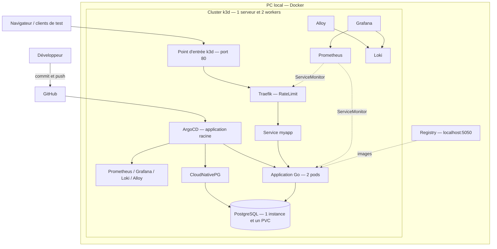

# DevOps Lab — k3d + ArgoCD

Une plateforme Kubernetes locale pour tester les déploiements GitOps et le
**rate limiting Traefik** avant de les adapter au cloud. Inspirée de
[k3d-argocd-template](https://github.com/WesleyCharlesBlake/k3d-argocd-template),
avec une application Go, PostgreSQL et une supervision dans Grafana.

## Ce que contient le lab

- **k3d / K3s** : un serveur et deux workers dans Docker.
- **ArgoCD** : une application racine déploie les composants depuis Git.
- **Traefik** : routage et limitation à 5 requêtes/s, avec une rafale de 10.
- **kube-prometheus-stack** : Prometheus, Grafana, Alertmanager et exporters.
- **Loki + Alloy** : collecte des logs de l’application et de Traefik.
- **CloudNativePG** : PostgreSQL géré par un opérateur avec stockage persistant.
- **Application Go** : API `/items` connectée à PostgreSQL, deux répliques et sondes.
- **Helm** : Ingress, Middleware, ServiceMonitor, alertes, PDB et dashboard.

La nouvelle plateforme se trouve dans `platform/`. L’ancien lab Kind et ses
données sont conservés : [procédure Kind](legacy/README-kind.md).
Les clusters, contextes Kubernetes et registries sont distincts.

## Prérequis

**Docker avec les conteneurs Linux, Git, Python 3.10+, kubectl et Helm.**
Make est facultatif. Le bootstrap peut télécharger k3d 5.9.0 depuis sa publication
officielle et vérifier son SHA256, sans installation globale.

Prévoir environ **8 Gio disponibles**, davantage si Kind reste lancé.
Les ports locaux **80, 443 et 5050** doivent être libres.

### Windows

Dans PowerShell, installer uniquement les outils manquants :

```powershell
winget install --exact --id Git.Git --source winget
winget install --exact --id Docker.DockerDesktop --source winget
winget install --exact --id Python.Python.3.12 --source winget
winget install --exact --id Kubernetes.kubectl --source winget
winget install --exact --id Helm.Helm --source winget
```

Rouvrir PowerShell et démarrer Docker Desktop avec WSL 2 et les conteneurs Linux.
Son Kubernetes intégré n’est pas nécessaire.

### macOS / Linux

Sur macOS avec Homebrew : `brew install git python kubectl helm`, puis installer
et démarrer Docker Desktop. Sur Linux, installer Docker Engine, Python 3, Git,
kubectl et Helm selon leurs instructions officielles. `docker info` doit fonctionner.

## Démarrage rapide

### Windows — PowerShell

```powershell
git clone https://github.com/yazid9871/Devops-lab.git
cd Devops-lab
python scripts/platform_lab.py bootstrap
```

### macOS / Linux

```bash
git clone https://github.com/yazid9871/Devops-lab.git
cd Devops-lab
make bootstrap
```

Sans Make : `python3 scripts/platform_lab.py bootstrap`.

Le bootstrap crée le cluster, construit et publie l’image dans le registry local,
installe ArgoCD, puis applique l’application racine. ArgoCD installe la plateforme.
Le script attend **Synced / Healthy**, puis teste une écriture et une lecture
PostgreSQL via l’API. L’élément de test est conservé.

Une relance conserve les volumes et les mots de passe. La première installation
télécharge plusieurs images et charts : attendre le résultat final.

### Accès

| Service | Adresse / commande |
|---|---|
| API et données | [http://myapp.localhost/items](http://myapp.localhost/items) |
| Santé du processus | [http://myapp.localhost/healthz](http://myapp.localhost/healthz) |
| Disponibilité avec la base | [http://myapp.localhost/readyz](http://myapp.localhost/readyz) |
| Dashboard Traefik | [http://grafana.localhost/d/traefik-k3d](http://grafana.localhost/d/traefik-k3d) |
| Dashboard application | [http://grafana.localhost/d/myapp-overview](http://grafana.localhost/d/myapp-overview) |
| ArgoCD | `python scripts/platform_lab.py argocd-ui`, puis `https://localhost:8080` |

Compte Grafana : **admin**. Pour afficher les mots de passe générés :

```powershell
python scripts/platform_lab.py grafana-password
python scripts/platform_lab.py argocd-password
```

Comme le modèle, l’application et Grafana utilisent **HTTP local**, à travers
Traefik et sans port-forward. Le port 443 est réservé mais aucun certificat
applicatif n’est provisionné dans ce profil. Le profil Kind conserve son HTTPS.
Si les noms ne se résolvent pas, ajouter
`127.0.0.1 myapp.localhost grafana.localhost` au fichier hosts du système.

## Architecture



### Comment une modification arrive dans le cluster

1. Modifier le code ou la configuration.
2. Si le code change, construire une image avec un **nouveau tag** et la publier.
3. Faire `git commit` puis `git push` de la configuration.
4. ArgoCD détecte le changement et réconcilie Kubernetes.
5. Vérifier **Synced / Healthy**, les réponses de l’application et Grafana.

Rollback : `git revert <commit>` puis `git push`. L’ancienne image doit rester
dans le registry. Cela ne restaure pas les données PostgreSQL.

## Composants et ordre de déploiement

| Wave | Composant | Rôle |
|---|---|---|
| -30 | kube-prometheus-stack | Supervision et CRD ServiceMonitor/PrometheusRule |
| -20 | Traefik, Loki | Routage, métriques et stockage des logs |
| -10 | CloudNativePG, Alloy, dashboards | Opérateur, collecte et vues Grafana |
| 0 | PostgreSQL | Base et Secret de connexion |
| 10 | myapp | API, deux répliques et PDB |

La racine attend la santé des applications enfants entre les waves. Le PDB
maintient au moins une réplique lors des interruptions volontaires respectant
l’API d’éviction ; il ne garantit pas la disponibilité lors d’une panne physique.

## Organisation du dépôt

```text
README.md
Makefile                         # raccourcis facultatifs
scripts/platform_lab.py          # commandes Windows/macOS/Linux
.github/workflows/platform.yml   # validation en CI
platform/
├── bootstrap/
│   ├── k3d-config.yaml          # nœuds, ports et registry
│   └── argocd/                  # racine et contrôles de santé
├── apps/
│   ├── tooling/                 # applications ArgoCD de la plateforme
│   └── workload/                # PostgreSQL et myapp
├── manifests/
│   ├── postgres/                # Cluster CloudNativePG
│   └── observability/           # dashboard Traefik
├── charts/myapp/                # Deployment, Service, Ingress, PDB, métriques
├── app/                         # application Go et migrations SQL
├── tests/                       # client HTTP exécuté dans des pods temporaires
├── UPSTREAM.md                  # origine et adaptations
└── LICENSE                      # licence MIT du code repris
legacy/README-kind.md            # ancien profil
```

Les dossiers historiques `app/`, `charts/devops-demo/`, `infra/`, `k8s/` et les
scripts PowerShell restent utilisés par Kind. Ne pas mélanger les commandes
des deux profils. Le manifeste ArgoCD déjà versionné est réutilisé au bootstrap.

## Tester Traefik, scénario par scénario

Lancer une commande, lire le résultat, puis regarder Grafana avant la suivante :

```powershell
python scripts/platform_lab.py test-traffic --scenario normal
python scripts/platform_lab.py test-traffic --scenario burst
python scripts/platform_lab.py test-traffic --scenario flood
python scripts/platform_lab.py test-traffic --scenario recovery
python scripts/platform_lab.py test-traffic --scenario spoof
python scripts/platform_lab.py test-traffic --scenario two-clients
```

| Scénario | Vérification |
|---|---|
| normal | 12 requêtes espacées passent |
| burst | Une rafale de 10 requêtes passe après recharge |
| flood | 100 requêtes rapides provoquent des 429 et respectent le budget de jetons |
| recovery | Après la rafale et la recharge, l’accès fonctionne de nouveau |
| spoof | Changer X-Forwarded-For ne contourne pas le quota |
| two-clients | Deux IP distinctes : la rafale de A ne bloque pas le trafic normal de B |

Sur macOS/Linux : `make test-normal`, `make test-flood`, `make test-two-clients`, etc.
Les pods clients sont supprimés à la fin. Les requêtes passent par le Service
Traefik en HTTP, depuis le cluster : cela ne simule pas un load balancer OVH externe.
Le quota reste en mémoire, **par instance Traefik**, avec une seule instance.

Dans Grafana, regarder les **codes HTTP**, puis les **requêtes reçues et transmises**.
Attendre deux collectes, environ 15 à 30 secondes. Les nombres sur 5 minutes
sont estimés ; les débits utilisent une moyenne sur 2 minutes.
Dans Explore, choisir Loki et saisir `{namespace="traefik"}` pour les logs
d’accès, ou `{namespace="workload",container="myapp"}` pour l’application.

## Développement et CI

Modifier `platform/app/`, choisir un nouveau tag dans
`platform/charts/myapp/values.yaml`, puis :

```powershell
python scripts/platform_lab.py dev-image
git diff
git add platform/app platform/charts/myapp/values.yaml
git commit -m "Deploy myapp with a new image tag"
git push origin main
```

`dev-image` construit et pousse l’image dans le registry local. ArgoCD déploie
le tag enregistré dans Git. Les images sont construites pour l’architecture du PC.
Ne pas réutiliser un tag pour une nouvelle version du code.

La CI vérifie Python, le chart Helm et la construction Go/Docker. Elle n’accède
pas au registry du PC et n’y publie pas d’image.

Pour utiliser votre propre dépôt public : modifier l’origin, lancer
`python scripts/platform_lab.py configure`, puis committer et pousser les fichiers
modifiés avant `bootstrap`.

## Exploitation

Sur macOS/Linux, remplacer `python` par `python3`, ou utiliser les cibles Make :

| Opération | Commande |
|---|---|
| État | `python scripts/platform_lab.py status` |
| Vérifier l’API, la base et les métriques | `python scripts/platform_lab.py verify` |
| Sauvegarder PostgreSQL | `python scripts/platform_lab.py backup` |
| Restaurer dans une instance séparée | `python scripts/platform_lab.py test-restore` |
| Ouvrir ArgoCD | `python scripts/platform_lab.py argocd-ui` |

Les archives logiques et SHA256 sont dans `backups/k3d/`, ignoré par Git.
La restauration utilise une nouvelle instance et un volume vide, restaure
l’archive complète et compare le nombre de lignes et l’empreinte de `items`.
Elle conserve la cible et le rapport, sans arrêter ni écraser la source.
Faire ce test sans écritures concurrentes.

Il n’y a pas encore de sauvegarde planifiée ni externe dans le profil k3d.
Le CronJob historique reste dans Kind.

### Dépannage

- **Installation bloquée** : `status`, puis les conditions ArgoCD et
  `kubectl --context k3d-devops-lab-k3d get pods -A`.
- **ImagePullBackOff** : vérifier le registry sur 5050 et relancer `dev-image`.
- **429 pendant une vérification** : arrêter les tests de charge et attendre la recharge.
- **Grafana inaccessible** : vérifier le pod dans `tooling` et la résolution du nom.
- **Ports occupés** : libérer 80/443/5050 avant de créer le cluster.
- **OOMKilled** : vérifier les limites et la mémoire attribuée à Docker.

## Limites du lab

Trois nœuds Docker sur un PC ne sont pas trois machines indépendantes.
Un seul serveur Kubernetes, une seule instance Traefik et une seule instance
PostgreSQL : ce profil n’est pas hautement disponible. Les volumes et sauvegardes
sur le même PC ne protègent pas contre sa perte.

Le lab valide des comportements et fournit des mesures locales. Il ne valide
pas la capacité d’OVH ni les seuils adaptés aux utilisateurs de Sobrus. Le chemin
réseau, la confiance des proxies et les versions doivent être comparés à la cible.

## Référence

Adapté de [WesleyCharlesBlake/k3d-argocd-template](https://github.com/WesleyCharlesBlake/k3d-argocd-template).
Voir [les adaptations](platform/UPSTREAM.md) et [la licence MIT](platform/LICENSE).
Alloy remplace Promtail ; aucun service Tempo ou Mimir séparé n’est installé.
