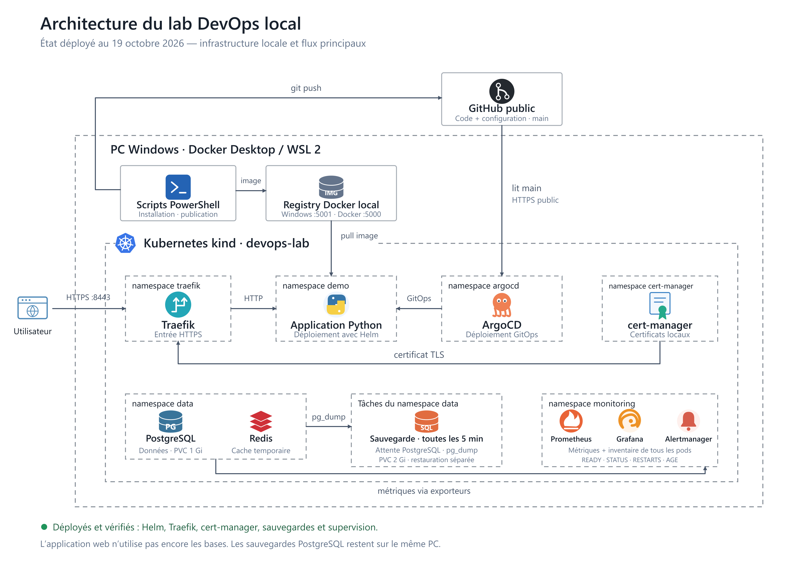
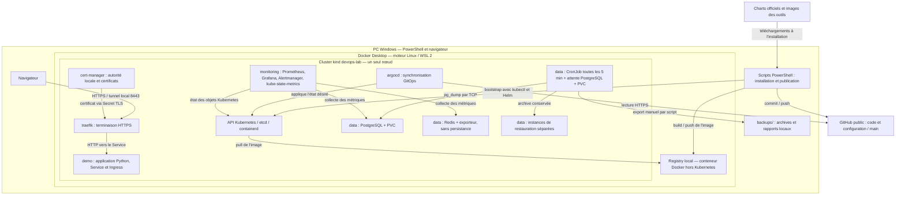
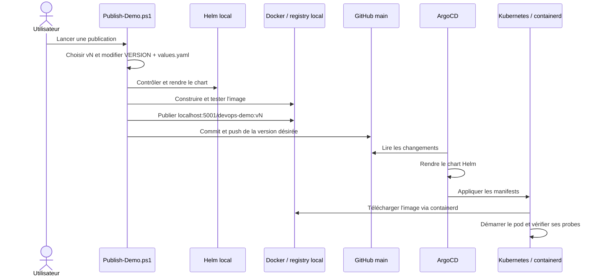
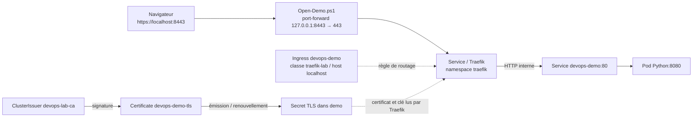
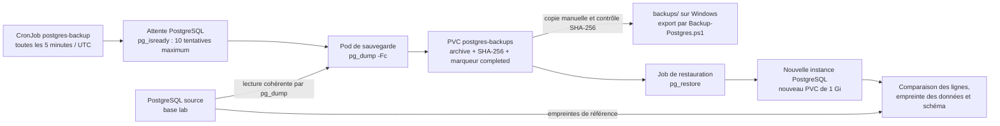
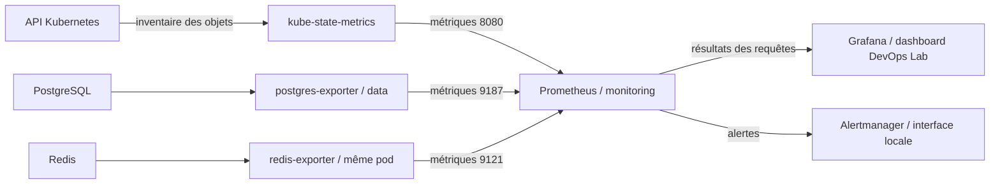

# Architecture détaillée du lab DevOps local

Document du 19 octobre 2026, établi à partir des fichiers du projet.

**Périmètre :** un PC Windows, Docker Desktop avec WSL 2, un cluster kind à un
seul nœud et des données fictives. GitHub et les registres de téléchargement
restent des dépendances externes. L'exécution des services du lab est locale.

**État au 19 octobre 2026 :** Helm, Traefik et cert-manager sont publiés et
déployés ; l'application est synchronisée et saine dans ArgoCD et son certificat
est prêt. L'installation contrôlée sur ce PC a duré 5,86 minutes avec prérequis
et certaines images déjà présents. Une restauration dans une instance vide a
récupéré quatre lignes en 12,96 secondes, hors sauvegarde.

La sauvegarde attend maintenant PostgreSQL avant `pg_dump`. Les contrôles de
reprise et une sauvegarde réelle avec SHA-256 ont réussi. Grafana affiche tous
les pods dans un tableau unique, vérifié dans le navigateur. Le renouvellement
réel des certificats et le parcours HTTPS complet restent à vérifier séparément.

## 1. Vue d'ensemble

### Schéma simplifié pour la présentation



[Version SVG modifiable](diagrams/architecture-locale.svg).
Le schéma décrit les composants maintenant déployés. Il conserve un seul PC et un seul cluster ; il ne représente pas les régions cloud ou les
environnements de production de la référence Sobrus.

### Vue technique complémentaire



Les flèches résument les échanges ; la partie sauvegarde/restauration est
détaillée plus bas. Les composants sont déployés dans le même cluster local.

**L'application Python ne se connecte actuellement ni à PostgreSQL ni à Redis.**
Ces deux services servent à des exercices d'exploitation indépendants. ArgoCD
n'est pas dans le chemin des requêtes HTTP des utilisateurs.

## 2. Les trois niveaux d'exécution

| Niveau | Composants | Fonction |
| --- | --- | --- |
| Windows | PowerShell, Git, Docker CLI, kind, kubectl, Helm, navigateur | Piloter le lab et consulter ses interfaces |
| Docker Desktop / WSL 2 | Moteur Linux, réseau Docker `kind`, registry et conteneur du nœud | Fournir l'environnement Linux sur le PC |
| Kubernetes dans kind | Un nœud `devops-lab-control-plane` avec containerd, API, etcd et workloads | Orchestrer les pods, services, volumes et tâches |

Le script de création référence `kindest/node:v1.37.0`. Le contexte kubectl est
toujours `kind-devops-lab`. Le nom `control-plane` ne désigne pas un autre PC :
ce nœud unique exécute aussi les applications. Le Kubernetes intégré de Docker
Desktop n'est pas utilisé.

CoreDNS assure la résolution des noms de services, kindnet fournit le réseau
des pods et le provisionneur local-path fournit la classe de stockage `standard`.
Cette organisation n'offre aucune haute disponibilité entre machines.

## 3. Organisation du cluster

| Namespace | Ressources principales | Rôle et mode de gestion |
| --- | --- | --- |
| `argocd` | Server, repo-server, application-controller, ApplicationSet controller, Dex, notifications, Redis interne | ArgoCD est installé à partir du manifest versionné du dépôt ; les quatre Applications sont créées par les scripts |
| `demo` | Deployment et Service `devops-demo`, Namespace, Ingress `devops-demo`, Certificate `devops-demo-tls` | Application sans état ; chart Helm rendu par ArgoCD ; Ingress et Certificate déployés |
| `data` | StatefulSet `postgres`, Deployment `redis`, Deployment `postgres-exporter`, CronJob `postgres-backup`, PVC et cibles de restauration | PostgreSQL et Redis via ArgoCD/Kustomize ; cibles de restauration créées par script |
| `monitoring` | Prometheus, Grafana, Alertmanager, kube-state-metrics, ConfigMaps, PVC | Application ArgoCD/Kustomize `monitoring-lab` |
| `traefik` | Deployment, Service `traefik`, RBAC et IngressClass `traefik-lab` de portée cluster | Release Helm installée par `Deploy-Access.ps1` ; déployée et vérifiée |
| `cert-manager` | Contrôleur, webhook, cainjector, Certificate et Secret de l'autorité racine | Release Helm et bootstrap PKI par `Deploy-Access.ps1` ; déployée et vérifiée |
| `kube-system` / `local-path-storage` | DNS, réseau, composants Kubernetes et provisionneur de volumes | Socle créé avec kind |

L'exporteur PostgreSQL est dans `data`, mais son manifest est dans
`k8s/monitoring/` : c'est l'Application `monitoring-lab` qui le gère. Les namespaces
organisent les objets ; ils n'isolent pas le réseau à eux seuls. Aucun manifest
NetworkPolicy n'est défini dans le projet.

Le Redis interne à ArgoCD et le Redis d'exercice dans `data` sont deux services
différents.

## 4. Chaîne CI/CD et GitOps



La CI est un **script local déclenché manuellement**, pas un workflow GitHub
Actions. Les contrôles inclus dans ces scripts seront exécutés lors de leur
lancement ultérieur par l'utilisateur ; ils ne l'ont pas été pour les ajouts actuels.

Le commit applicatif modifie `app/VERSION` et
`charts/devops-demo/values.yaml`. Le helper `Lab-DemoChart.ps1` impose leur
cohérence et l'usage du registry local. La version du chart, `0.2.0`, est distincte
du tag de l'application, par exemple `v1`.

| Application ArgoCD | Source dans Git | Rendu | Destination |
| --- | --- | --- | --- |
| `devops-demo` | `charts/devops-demo` | Helm, releaseName `devops-demo` | `demo` |
| `postgres-lab` | `k8s/postgres` | Kustomize | `data` |
| `redis-lab` | `k8s/redis` | Kustomize | `data` |
| `monitoring-lab` | `k8s/monitoring` | Kustomize | `monitoring` et exporteur dans `data` |

Les Applications suivent `main`, dans le projet ArgoCD `default`, avec
synchronisation automatique et `selfHeal: true`. `prune: false` évite la
suppression automatique des objets retirés de Git ; il ne remplace pas une
sauvegarde et peut laisser des ressources anciennes dans le cluster.

Les scripts remplacent `OWNER/REPOSITORY` en mémoire à partir de `git remote
get-url origin`. La lecture visée est en HTTPS public, sans clé ni token. Une
Application déjà liée à un autre dépôt est refusée. Les manifests de ces
Applications doivent être utilisés par les scripts, pas appliqués tels quels.

**Retour arrière :** `git revert` du commit de publication, puis `git push`.
ArgoCD applique l'ancien tag. L'image précédente doit encore être disponible.
Ce mécanisme ne revient pas sur une migration de base de données et ne doit
pas être confondu avec `helm rollback` : ArgoCD gère lui-même l'application.

Traefik et cert-manager sont, eux, des releases Helm explicites. Leurs valeurs
sont dans Git, mais elles ne sont pas synchronisées automatiquement par ArgoCD.
Leur modification s'applique par une relance de `Deploy-Access.ps1`.

## 5. Réseau, ports et parcours HTTPS

### Registry et images

Le registry `devops-lab-registry` est un conteneur Docker **extérieur au cluster**,
connecté au même réseau Docker que le nœud kind.

| Depuis | Adresse | Utilisation |
| --- | --- | --- |
| PowerShell / Docker Windows | `localhost:5001` | Push des images et lecture de l'API du registry |
| Nœud kind | `devops-lab-registry:5000` | Accès au même registry dans le réseau Docker |
| Référence dans le Deployment | `localhost:5001/devops-demo:vN` | Nom d'image traduit par la configuration containerd |

`infra/registry/hosts.toml` indique à containerd que les images référencées avec
`localhost:5001` doivent être téléchargées depuis
`http://devops-lab-registry:5000`. Le port Windows est lié à `127.0.0.1`, en HTTP,
sans authentification. Les images sont dans le volume Docker nommé
`devops-lab-registry-data`.

### HTTPS de l'application — composants déployés



Le tunnel transporte TLS jusqu'à Traefik. Celui-ci termine HTTPS et transmet en
HTTP au Service de l'application. Le Service vise le port nommé `http` du pod,
qui écoute sur 8080. Aucun accès aux bases n'intervient dans cette requête.

L'Ingress utilise uniquement l'entrée `websecure`. Il n'y a pas de redirection
HTTP automatique configurée. Traefik n'est pas exposé par un LoadBalancer cloud
ou un NodePort ; son Service est un `ClusterIP`. Le tunnel doit rester ouvert.

La PKI déployée suit cette chaîne :

1. `devops-lab-selfsigned` crée une racine autosignée.
2. Le Certificate racine et son Secret sont dans `cert-manager`.
3. Le ClusterIssuer `devops-lab-ca` utilise cette racine.
4. Le Certificate de `demo` demande un certificat serveur pour `localhost`.
5. cert-manager remplit le Secret `devops-demo-tls`, consommé par Traefik.

Le certificat serveur est demandé pour 90 jours, avec renouvellement 15 jours
avant expiration et rotation de clé. La racine est demandée pour dix ans. Ce
renouvellement est configuré, mais pas encore observé. La confiance Windows
nécessite un import explicite pour l'utilisateur courant ; elle n'est pas
modifiée automatiquement par l'installation.

### Services et accès opérateur

| Service | Port interne | Accès depuis le PC |
| --- | --- | --- |
| Application via Traefik | Service Traefik 443 | `https://localhost:8443` avec `Open-Demo.ps1` |
| Application directe | Service 80 → conteneur 8080 | `http://localhost:8081` avec tunnel de diagnostic |
| ArgoCD | Service `argocd-server` 443 | `https://localhost:8080` avec tunnel |
| Grafana | 3000 | `http://localhost:3000` avec tunnel |
| Prometheus | 9090 | `http://localhost:9090` avec tunnel |
| Alertmanager | 9093 | Interface interne ; tunnel spécifique possible |
| PostgreSQL | 5432, Service headless | Accès interne et commandes `kubectl exec` |
| Redis | 6379 | Accès interne uniquement dans les manifests |
| Exporteur PostgreSQL | 9187 | Collecté par Prometheus |
| Exporteur Redis | 9121 | Collecté par Prometheus |
| kube-state-metrics | 8080 | Collecté par Prometheus |

Les adresses d'interfaces ne répondent que si le service est disponible et que
le tunnel correspondant est ouvert. Le certificat d'ArgoCD est distinct de la
nouvelle PKI applicative.

## 6. Données, sauvegarde et restauration

### PostgreSQL et Redis

PostgreSQL utilise un StatefulSet à une réplique (`postgres-0`), la base et
l'utilisateur `lab`, ainsi qu'un PVC de données de 1 Gi. Ses identifiants sont
générés localement dans `postgres-credentials`. Le jeu fictif est initialisé par
ConfigMap et contient la table `demo_items`.

Le Service PostgreSQL est headless (`clusterIP: None`). Les clients du lab
utilisent `postgres.data.svc.cluster.local:5432`. Les tests passent par TCP et
authentification. Aucune configuration TLS PostgreSQL n'est définie dans le projet.

Redis utilise un Deployment à une réplique, avec deux conteneurs dans le même
pod : Redis et `redis-exporter`. L'exporteur se connecte à Redis en loopback.
Le mot de passe vient de `redis-credentials`. La persistance RDB/AOF est désactivée,
la limite Redis est 96 Mio et la politique d'éviction est `allkeys-lru`. Les
volumes `emptyDir` sont temporaires : il s'agit d'un cache, pas d'une base sauvegardée.

### Flux de sauvegarde et de restauration



Avant de créer le dossier de sauvegarde, `pg_isready` vérifie la disponibilité
de PostgreSQL : dix tentatives maximum, timeout de deux secondes et pauses de
quatre secondes. Une indisponibilité persistante provoque un échec visible et
alerté. Cette attente absorbe notamment un retard de résolution DNS au démarrage.

Le CronJob utilise `concurrencyPolicy: Forbid`, pour ne pas empiler ses propres
exécutions planifiées. L'archive est d'abord écrite en `.partial`, contrôlée par
`pg_restore --list`, renommée, accompagnée d'un SHA-256 et d'un marqueur de fin.
Ce sont les archives, pas les Pods/Jobs, qui contiennent les sauvegardes utiles.

`Backup-Postgres.ps1` lance un Job immédiat, exporte l'archive vers Windows et
contrôle son SHA-256. Cet export n'est pas planifié automatiquement.

`Test-Restore.ps1` ajoute une ligne fictive, sauvegarde, crée une nouvelle
instance vide, puis restaure. Il contrôle le SHA-256, l'absence initiale de tables
utilisateur et les empreintes de données/schéma. La comparaison du schéma couvre
les colonnes, contraintes et index du jeu de données. La source n'est pas remplacée.

Chaque cible est conservée avec son volume : aucune bascule applicative et aucun
nettoyage des cibles ne sont automatisés. Le script ne propose pas encore de
sélectionner une ancienne archive. Les rôles globaux, propriétaires et ACL ne
sont pas reconstruits. Le chronométrage du rapport commence après la sauvegarde.

### Persistance

| Données | Support demandé | Persistance et limites |
| --- | --- | --- |
| Images applicatives | Volume Docker `devops-lab-registry-data` | Distinct du conteneur registry ; même PC |
| PostgreSQL source | PVC `postgres-data-postgres-0`, 1 Gi | Classe `standard`, rétention demandée lors de la suppression/réduction du StatefulSet |
| Archives SQL | PVC `postgres-backups`, 2 Gi | Volume distinct des données, même PC ; rétention des archives non automatisée |
| Chaque cible de restauration | PVC distinct de 1 Gi | Conservée après le test |
| Prometheus | PVC `prometheus-data`, 2 Gi | Rétention des métriques limitée à 6 h et 1 Go par les paramètres Prometheus |
| Grafana | PVC `grafana-data`, 1 Gi | Base Grafana locale ; dashboard et sources aussi décrits dans Git |
| Redis | `emptyDir` | Perdu au remplacement du pod |
| Alertmanager | `emptyDir` | État local éphémère, pas de PVC |
| Autorité et certificats TLS | Secrets Kubernetes, dans etcd | Hors Git ; pas couverts par les dumps SQL |
| Exports et rapports Windows | `backups/`, `work/` | Exclus de Git, sur le même PC |

Les PVC du socle demandent **6 Gi au total**, hors cibles de restauration,
registry et stockage système. Ce sont des capacités demandées, pas une mesure
d'occupation réelle. local-path stocke les données dans le nœud kind : la survie
à un remplacement de pod ne garantit pas une reprise après perte du nœud ou du PC.

## 7. Supervision et alertes



Prometheus interroge quatre cibles statiques : lui-même, kube-state-metrics,
l'exporteur PostgreSQL et l'exporteur Redis. La collecte et l'évaluation ont une
période de 15 secondes. Grafana interroge Prometheus ; ce n'est pas Grafana qui
collecte directement les métriques PostgreSQL ou Redis.

Le dashboard `devops-lab` montre l'inventaire de tous les pods, avec `demo` en
premier : `NAMESPACE`, `NAME`, `READY`, `STATUS`, `RESTARTS` et `AGE`.
La requête utilise le format table pour réunir tous les pods dans un seul tableau.
Les phases `Succeeded` et `Failed` sont affichées `Completed` et `Error`. Les pods
Traefik/cert-manager sont visibles dans cet inventaire ;
**aucune cible de collecte de leurs métriques propres n'est encore ajoutée**.

| Alerte | Condition principale | Délai configuré |
| --- | --- | --- |
| `LabPodError` | Pod Failed ou certains états d'attente en erreur, dans `demo` ou `data` | 1 minute |
| `LabPostgresUnavailable` | PostgreSQL, exporteur ou métrique indisponible | 1 minute |
| `LabBackupFailed` | Job de sauvegarde échoué, absence de succès depuis 15 min ou métrique absente | 1 minute après condition |
| `LabRedisUnavailable` | Redis/exporteur indisponible, quand le Deployment Redis est demandé actif | 1 minute |

La règle de pod ne couvre pas actuellement les namespaces des nouveaux
contrôleurs. Alertmanager regroupe les alertes, mais son receiver `local-ui`
n'envoie ni email ni message externe. Les règles ont des scénarios à métriques
simulées ; une panne réelle de bout en bout n'est pas établie par ces scénarios.

## 8. Installation et répartition des fichiers

Le point d'entrée `scripts/Install-Lab.ps1` orchestre :

1. La présence des outils, le dépôt public, `main` et sa synchronisation Git.
2. Le cluster, le registry et ArgoCD par `Start-Lab.ps1`.
3. Traefik, cert-manager et l'autorité locale par `Deploy-Access.ps1`.
4. L'application Helm via ArgoCD, puis son contrôle HTTP interne.
5. PostgreSQL et son CronJob, puis Redis.
6. Une restauration sur une nouvelle cible.
7. La supervision et ses contrôles.
8. Un rapport de durée dans `work/install-report.json`.

Le script contient des contrôles qu'il exécutera lors de son lancement : sa
présence dans le dépôt ne prouve pas qu'ils ont déjà réussi pour les ajouts récents.
Le rapport distingue le certificat prêt de la validation HTTPS, qui exige le
tunnel et reste indiquée `HttpsEndpointTested=false` par l'installation.

```text
Devops-lab/
├── README.md                  Installation Windows et lancement du lab
├── app/                       Serveur Python, VERSION et Dockerfile
├── charts/devops-demo/         Chart de l'application et accès HTTPS
│   ├── Chart.yaml
│   ├── values.yaml
│   ├── values.schema.json
│   └── templates/             Namespace, Deployment, Service, Ingress, Certificate
├── infra/
│   ├── argocd/                Installation ArgoCD et quatre Applications
│   ├── registry/              Correspondance registry Windows / containerd
│   └── access/                Versions et valeurs Helm Traefik/cert-manager, PKI
├── k8s/
│   ├── postgres/              Base, volumes, init, dump, restauration et vérification
│   ├── redis/                 Cache et exporteur
│   ├── monitoring/            Collecte, dashboards et alertes
│   └── restore/               Modèles des nouvelles cibles de restauration
├── scripts/                   Installation, publication, accès et contrôles
├── docs/                      Architecture, runbook et comptes rendus
├── backups/                   Archives et rapports locaux, ignorés par Git
└── work/                      Rapports et certificat public exporté, ignorés par Git
```

L'ancien répertoire applicatif `k8s/demo/` est remplacé dans les modifications
locales par le chart. Les composants de données et de supervision gardent Kustomize.

## 9. Sécurité, frontières et limites

Les mots de passe du lab sont générés dans des Secrets locaux et ne sont pas
committés. La clé privée de l'autorité reste dans Kubernetes. Aucun chiffrement
au repos d'etcd n'est configuré par le projet : un Secret n'est pas un coffre-fort
simplement parce que ses champs sont encodés en base64.

L'application s'exécute sans root, avec système de fichiers en lecture seule,
capabilities supprimées et token de ServiceAccount désactivé. Plusieurs autres
workloads appliquent des protections similaires. Les composants de contrôle
et kube-state-metrics ont les accès API nécessaires à leur fonctionnement.
Le lab conserve des droits d'administration larges pour l'opérateur.

La publication nécessite un compte autorisé à écrire dans GitHub. Tous les labs
suivant le même dépôt reçoivent les mêmes changements, mais chaque registry est
local à son PC : l'image publiée sur un PC n'apparaît pas automatiquement sur l'autre.

Le lab n'intègre actuellement ni Ceph/Rook, ni Velero/Restic/S3, ni Harbor, ni
Trivy/Falco, ni VPN, ni séparation de clusters admin/production. Il ne prouve
pas une protection contre la perte du PC, une politique de sauvegarde 3-2-1,
une haute disponibilité ou les performances de la production Sobrus.

Le test sur un autre PC avec le README seul et la durée de moins de 30 minutes
reste à réaliser. La préparation Windows et des outils est mesurée séparément.

## 10. Comment présenter cette architecture

« Mon PC héberge un cluster Kubernetes local. Un script construit l'image et la
publie dans un registry local ; Git conserve la configuration et ArgoCD l'applique.
J'utilise Helm pour organiser l'application, Traefik pour son accès et
cert-manager pour les certificats. PostgreSQL sert au scénario de sauvegarde et
restauration : une sauvegarde est programmée toutes les cinq minutes. Redis sert
à un exercice de cache, et Prometheus/Grafana à la supervision de tous les pods.
Ces services sont indépendants de l'application web dans la version actuelle.
Le runbook décrit les opérations, les résultats attendus et les limites. »

Liens : [runbook](runbook.md), [Helm](helm.md), [HTTPS](https-local.md),
[sauvegarde/restauration](sauvegarde-restauration.md), [supervision](supervision.md),
[comparaison avec Sobrus](comparaison-sobrus.md).
