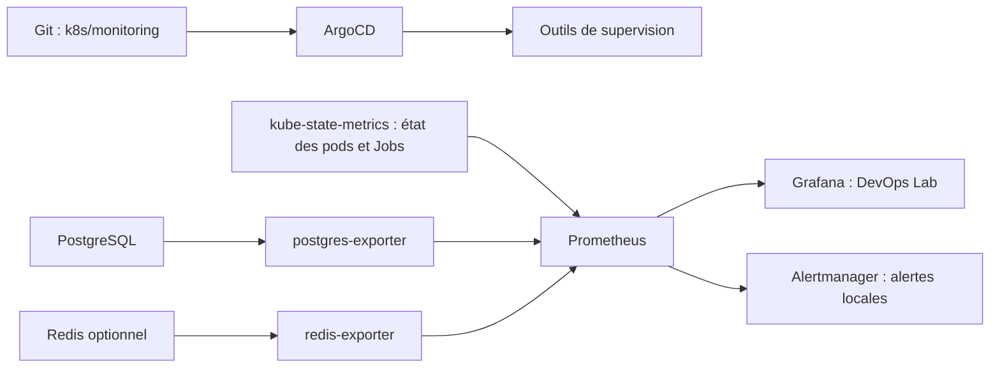

# Comprendre la supervision

Prometheus collecte des mesures toutes les 15 secondes. Grafana les affiche.
Alertmanager regroupe les alertes dans son interface locale. Aucun email ni message
externe n'est envoyé.

Les manifests sont dans `k8s/monitoring`, déployés par l'application ArgoCD
`monitoring-lab`. Les outils sont dans le namespace `monitoring` ; l'exporteur
PostgreSQL est dans `data` pour utiliser le Secret déjà présent.



## Installer et vérifier

Depuis le dossier du projet, après PostgreSQL et la sauvegarde :

```powershell
.\scripts\Deploy-Monitoring.ps1
```

Le script crée un mot de passe Grafana local, puis laisse ArgoCD installer les
outils. Une relance garde le mot de passe et les volumes. Le dernier commit doit
être poussé sur GitHub pour qu'ArgoCD le lise.

Pour vérifier plus tard :

```powershell
.\scripts\Test-Monitoring.ps1
```

Le test contrôle les trois cibles de base, `pg_up=1`, la présence d'une
sauvegarde planifiée réussie, les quatre règles, Grafana et Alertmanager. Si Redis
est installé, sa quatrième cible doit répondre et `redis_up` doit valoir 1. Il teste
les erreurs avec des séries simulées et `promtool`, sans arrêter la base.
Sur une installation neuve, attendre la première sauvegarde (jusqu'à cinq minutes)
si le test signale qu'aucun succès n'est encore visible.

## Ouvrir les interfaces

Garder ce terminal ouvert :

```powershell
kubectl --context kind-devops-lab -n monitoring port-forward svc/grafana 3000:3000
```

Ouvrir http://localhost:3000, utilisateur `admin`. Dans un autre terminal,
afficher le mot de passe local :

```powershell
$encoded = kubectl --context kind-devops-lab -n monitoring get secret lab-grafana-admin -o jsonpath='{.data.admin-password}'
[Text.Encoding]::UTF8.GetString([Convert]::FromBase64String($encoded))
```

Ouvrir **Dashboards > DevOps Lab > DevOps Lab**, ou directement
http://localhost:3000/d/devops-lab.
Le tableau montre la disponibilité de PostgreSQL, les pods en erreur, les Jobs de
sauvegarde échoués, l'âge de la dernière sauvegarde, les alertes actives et les pods
actifs par namespace. Il ne mesure pas le CPU ou la mémoire des conteneurs.

Trois compteurs indiquent les pods présents, les pods actifs (`Running` ou
`Pending`) et les pods terminés (`Succeeded` ou `Failed`). Ils suivent le filtre
**Namespace des compteurs**. Le tableau **Liste des pods** affiche une ligne par pod : namespace,
nom, état Kubernetes, conteneurs prêts et redémarrages des conteneurs applicatifs.
Les conteneurs d'initialisation ne sont pas inclus dans ces deux derniers champs.
Le tableau affiche toujours tous les namespaces et tous les etats, independamment
du filtre des compteurs. Les pods `demo` sont places en premier, puis les autres
sont tries par namespace et nom. Les mesures sont
rafraîchies toutes les 15 secondes ; un changement peut mettre quelques secondes
à apparaître. Un pod supprimé disparaît du tableau après la collecte suivante.
Après un redémarrage de Prometheus, les compteurs et le tableau ignorent aussi les
séries de pods dont la dernière collecte date de plus de 60 secondes.

Pour les règles Prometheus, ouvrir un autre terminal :

```powershell
kubectl --context kind-devops-lab -n monitoring port-forward svc/prometheus 9090:9090
```

Ouvrir http://localhost:9090/alerts. Pour Alertmanager :

```powershell
kubectl --context kind-devops-lab -n monitoring port-forward svc/alertmanager 9093:9093
```

Ouvrir http://localhost:9093. Une page sans alerte active est normale si tout va bien.
`Ctrl+C` ferme uniquement le tunnel du terminal concerné.

## Les trois alertes et les premières vérifications

Ces trois alertes couvrent les critères du sujet. Une quatrième,
`LabRedisUnavailable`, surveille le Redis optionnel : voir le [guide Redis](redis.md).
Le panneau **Redis disponible (1 = oui)** est ajouté au dashboard.

Chaque condition doit durer une minute avant de passer de `pending` à `firing`.

| Alerte | Ce qui la déclenche | Première action |
| --- | --- | --- |
| `LabPodError` | Pod `Failed`, `CrashLoopBackOff`, image introuvable ou configuration invalide, dans `demo` ou `data` | Lire `describe pod` et les logs. Un pod de sauvegarde terminé avec succès ne déclenche pas cette règle. |
| `LabPostgresUnavailable` | `pg_up=0`, exporteur inaccessible ou métrique absente | Vérifier PostgreSQL **et** son exporteur. Une panne de collecte peut déclencher cette alerte même si la base répond. |
| `LabBackupFailed` | Job de sauvegarde échoué, dernier succès vieux de plus de 15 minutes, ou métrique de succès absente | Lire les logs du Job, vérifier le CronJob et l'espace du volume. |

Commandes de diagnostic :

```powershell
kubectl --context kind-devops-lab -n demo get pods
kubectl --context kind-devops-lab -n data get pods
kubectl --context kind-devops-lab -n data logs postgres-0 --tail=50
kubectl --context kind-devops-lab -n data logs deployment/postgres-exporter --tail=50
.\scripts\Test-Postgres.ps1
kubectl --context kind-devops-lab -n data get cronjob,jobs
kubectl --context kind-devops-lab -n data exec postgres-0 -- df -h /backups
```

Pour un pod ou un Job précis, remplacer `NOM` par le nom affiché :

```powershell
kubectl --context kind-devops-lab -n data describe pod NOM
kubectl --context kind-devops-lab -n data logs job/NOM
```

Après correction d'une sauvegarde, lancer `Backup-Postgres.ps1`, puis vérifier la
prochaine exécution planifiée. Un ancien Job échoué peut garder l'alerte active
tant qu'il est conservé par Kubernetes : distinguer ce Job de la sauvegarde récente
dans les labels de l'alerte. Ne pas supprimer un historique avant son diagnostic.

Une règle redevenue normale se résout automatiquement. Corriger la cause avant
de considérer le problème terminé ; une alerte masquée n'est pas une réparation.

## Limites du lab

- Prometheus garde jusqu'à six heures de mesures, ou 1 Go de blocs. Son volume
  fait 2 Go ; celui de Grafana fait 1 Go. Les volumes restent sur le même PC.
- Alertmanager utilise un volume temporaire : ses silences et son historique
  interne disparaissent quand son pod est remplacé.
- ArgoCD conserve les anciennes ConfigMaps lors des mises à jour. Elles sont
  ignorées dans le calcul de synchronisation ; les pods utilisent la configuration
  référencée dans Git. Aucun nettoyage automatique des données n'est activé.
- La collecte des objets et le tableau des pods couvrent tous les namespaces,
  y compris `argocd` et `kube-system`. Les alertes pods ciblent `demo` et `data`.
- Il n'y a pas d'alerte indépendante si le PC, Prometheus ou tout le cluster tombe.
- L'exporteur réutilise le compte fictif du lab. En production, prévoir un compte
  de supervision avec des droits limités, des accès protégés et un stockage externe.
- Le succès du Job indique que le script de sauvegarde a terminé ses contrôles.
  Seul un test de restauration confirme que les données sont récupérables.
- Les tests d'alertes simulent les métriques ; ils ne prouvent pas encore le délai
  complet de notification lors d'une vraie panne du cluster.

Références : [Prometheus et promtool](https://prometheus.io/docs/prometheus/latest/configuration/unit_testing_rules/),
[postgres-exporter](https://github.com/prometheus-community/postgres_exporter),
[métriques des CronJobs](https://github.com/kubernetes/kube-state-metrics/blob/main/docs/metrics/workload/cronjob-metrics.md).
